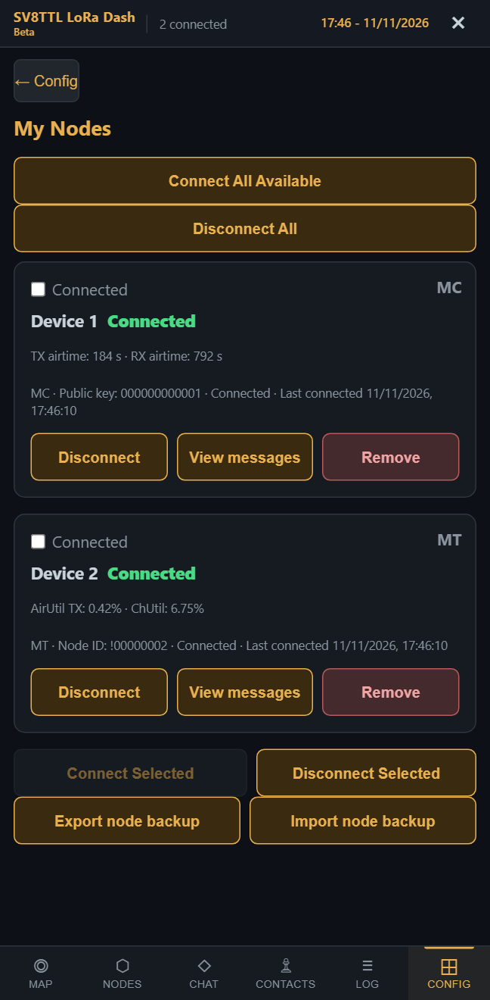
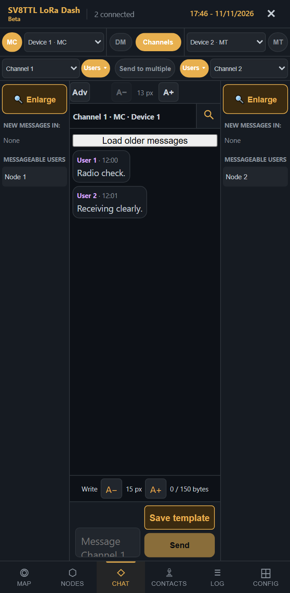
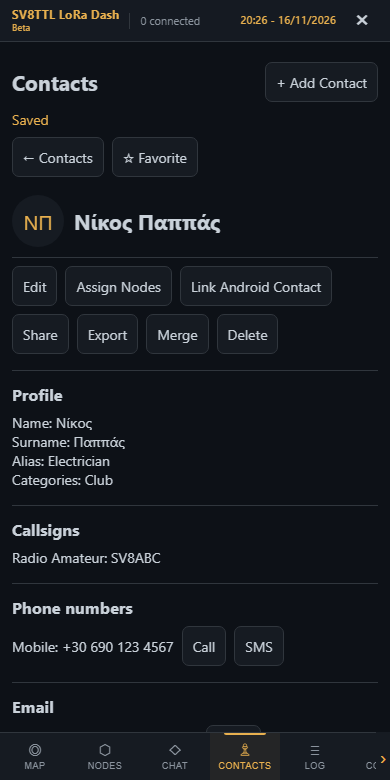
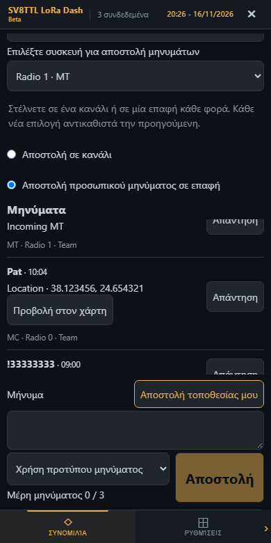
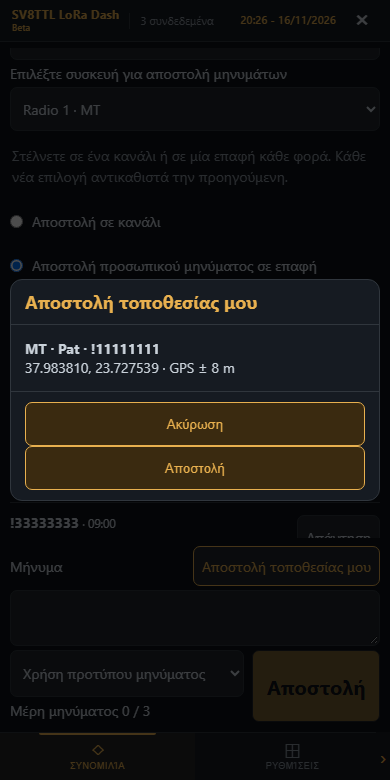
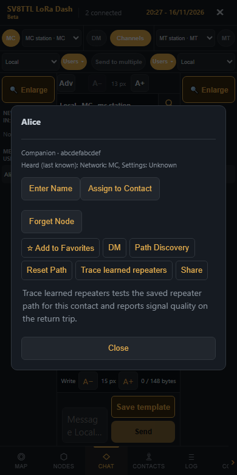
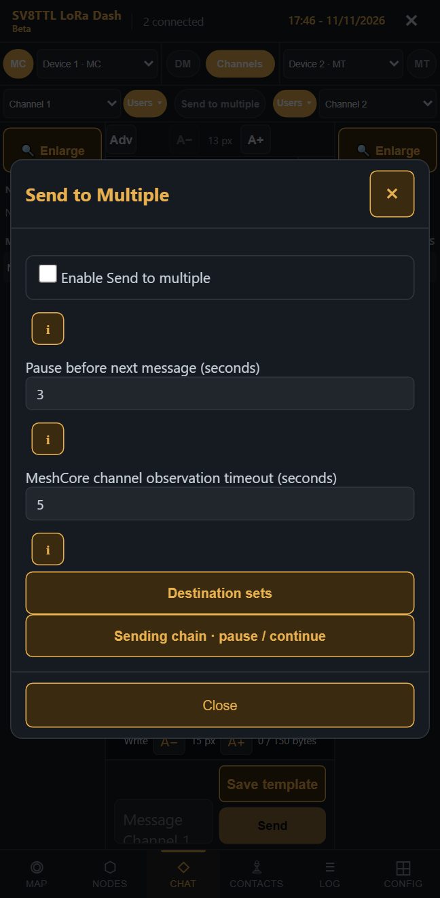
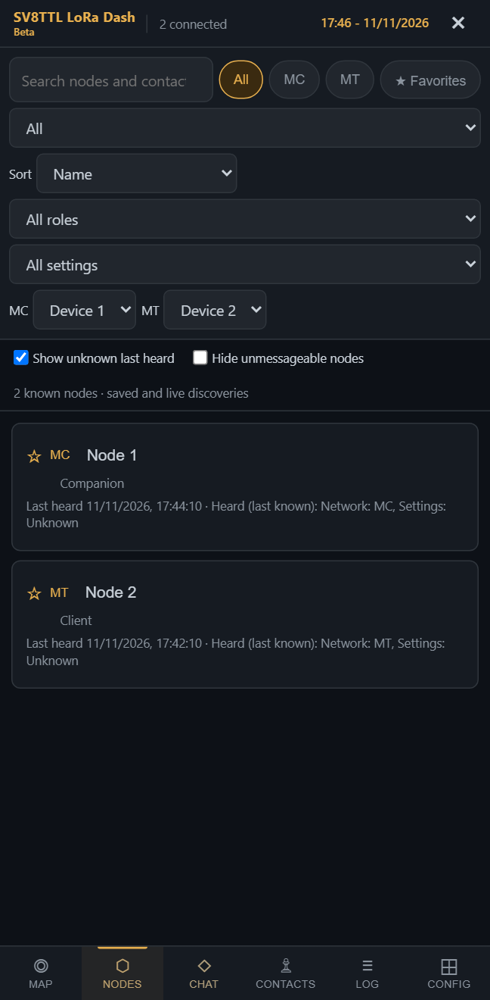

# SV8TTL LoRa Dash

**Beta · Εγχειρίδιο χρήσης**  
Για την έκδοση **0.10.35 (62)** · 20 Νοεμβρίου 2026

Γλώσσα: [English](USER-MANUAL.md) · **Ελληνικά**

Το SV8TTL LoRa Dash είναι μια αυτόνομη εφαρμογή Android για σύνδεση με ασυρμάτους MeshCore και Meshtastic μέσω Bluetooth Low Energy ή σειριακής σύνδεσης USB. Μπορούν να συνδεθούν ταυτόχρονα πολλοί ασύρματοι, περισσότεροι από δύο, ακόμη και των δύο οικογενειών μαζί: η εφαρμογή δεν επιβάλλει συγκεκριμένο όριο συσκευών, αλλά το πρακτικό μέγιστο εξαρτάται από το τηλέφωνο και τις συνδέσεις και δεν έχει ακόμη προσδιοριστεί με δοκιμές σε πραγματικές συσκευές. Το Chat διαθέτει δύο θέσεις προβολής συσκευών, με επιλογείς για εναλλαγή μεταξύ όλων των συνδεδεμένων ασυρμάτων. Η βασική ανταλλαγή μηνυμάτων λειτουργεί χωρίς διαδίκτυο, υπολογιστή Windows ή σύνδεση ασυρμάτου μέσω TCP.

**Νέοι χρήστες:** Με τη **Λειτουργία για μη εκπαιδευμένα μέλη** μπορείτε να επιλέξετε έναν προορισμό, να στείλετε μήνυμα ή την τοποθεσία του τηλεφώνου και να απαντήσετε από μία οθόνη. Πριν ενεργοποιήσετε τη λειτουργία, ανοίξτε το **Contacts**. Εκεί φτιάχνετε τον κατάλογο της ομάδας και συνδέετε κάθε άτομο με τους κόμβους MC και MT που χρησιμοποιεί. Στη συνέχεια επιλέγετε ποιες επαφές και ποια κανάλια θα βλέπει το μέλος.

Πρόκειται για ανεξάρτητη προσαρμογή για Android, βασισμένη στο OverMesh Lite, η οποία ενσωματώνει πρωτότυπα στοιχεία του OverMesh. Δεν αποτελεί επίσημη έκδοση του OverMesh. Οι αναφορές δημιουργών και οι άδειες βρίσκονται στο **Config → About** και στο [LICENSE](LICENSE).

Οι εικόνες δείχνουν το περιβάλλον της εφαρμογής σε διαστάσεις οθόνης τηλεφώνου με φανταστικά ονόματα, αναγνωριστικά, μηνύματα και ενδεικτικές μετρήσεις. Οι εκκρεμείς δοκιμές σε τηλέφωνο και ασυρμάτους καταγράφονται στο [PHONE-TESTS.md](PHONE-TESTS.md).

## Αλλαγές στην έκδοση 0.10.35

- Οι επιλογείς συσκευών στο Chat διατηρούν την επιλογή σας κατά την εναλλαγή, ακόμη και κατά την επιστροφή από τρίτη συσκευή.
- Το **Send position**, πάνω από το **Send** στο Chat καναλιού, λαμβάνει τη θέση του τηλεφώνου και ζητά επιβεβαίωση πριν τη στείλει στο επιλεγμένο radio/κανάλι. Η αλλαγή προορισμού πριν την επιβεβαίωση εμποδίζει την αποστολή.
- Τα **Templates** και **Save template** βρίσκονται κάτω από τα κουμπιά μεγέθους γραμματοσειράς και πάνω από το πλαίσιο κειμένου. Εμφανίζονται μόνο κατά τη σύνταξη μηνύματος.
- Το **Heard directly (0 hops)** αποκλείει επίσης κόμβους MT που αναφέρουν θετικό αριθμό αλμάτων, ακόμη κι αν παλαιότερο δείγμα είχε μηδέν.
- Όταν λείπουν οι ρυθμίσεις λήψης MT, εμφανίζεται το γνωστό preset της συσκευής λήψης. Οι καταγεγραμμένες ρυθμίσεις έχουν προτεραιότητα.
- Το **Search nodes** βρίσκεται μέσα στο πλαίσιο φίλτρων του Map, με το ίδιο στυλ. Η επιλογή κόμβου δεν προσθέτει πλέον γραμμή Selected πάνω από τον χάρτη.
- Οι ομαδοποιημένοι δείκτες δείχνουν σύντομο όνομα και χρυσή ένδειξη **+N** για τους επιπλέον κόμβους. **+1** σημαίνει δύο κόμβους συνολικά. Πατήστε για την πλήρη λίστα.

Εκκρεμεί έλεγχος σε πραγματικό τηλέφωνο και ασυρμάτους.

## Αλλαγές στην έκδοση 0.10.34

### Chat και Nodes

Οι επιλογείς καναλιών κάτω από τα ονόματα των συσκευών έχουν φωτεινότερα, έντονα γράμματα. Οι επιλογές εξακολουθούν να προέρχονται από το επιλεγμένο radio.

Στο **Nodes**, τα ονόματα των συνδεδεμένων επαφών εμφανίζονται δίπλα στο όνομα του κόμβου. Ανοίξτε τις λεπτομέρειες για την τελευταία αποθηκευμένη αναφορά σήματος του radio λήψης: SNR, RSSI όταν διατίθεται, χρόνο και ρυθμίσεις λήψης. Πράσινο, κίτρινο, πορτοκαλί και κόκκινο δηλώνουν σταδιακά χειρότερες τιμές, με τα όρια του μετρητή Meshtastic. Η αξιολόγηση SNR εξαρτάται από το καταγεγραμμένο spreading factor/preset· άγνωστες ρυθμίσεις δεν βαθμολογούνται. Σε αναμεταδιδόμενα πακέτα οι τιμές αφορούν το τελευταίο άλμα. Τα MeshCore V3 DM παρέχουν SNR αλλά όχι RSSI. Ελλείπουσες μετρήσεις δεν αντικαθίστανται με μηδενικά.

Το **Heard directly (0 hops)** επιλέγει κόμβους των οποίων η τελευταία καταγεγραμμένη λήψη είχε μηδέν εισερχόμενα άλματα, εξαιρώντας MQTT. Δεν εγγυάται σημερινή επικοινωνία. Το πεδίο διαθεσιμότητας αφαιρέθηκε.

Το **Show on map** κεντράρει και μεγεθύνει τον χάρτη στον κόμβο και ανοίγει τις λεπτομέρειές του. Είναι γκρι όταν δεν υπάρχουν συντεταγμένες. Μια αποθηκευμένη θέση δεν είναι απαραίτητα πρόσφατη.

### Επαφές: Groups (Ομάδες)

Οι Categories των επαφών μετονομάστηκαν σε **Groups**, διατηρώντας τις υπάρχουσες συμμετοχές. Μια επαφή μπορεί να ανήκει σε πολλές ομάδες, που εμφανίζονται η μία κάτω από την άλλη. Στο **Edit → Groups**, επιλέξτε υπάρχουσα ομάδα από το **Add to group**. Οι επιλεγμένες ομάδες εμφανίζονται δίπλα στο αναπτυσσόμενο μενού. Πατήστε × για αφαίρεση συμμετοχής και **Save Contact** για αποθήκευση. Το **New group / Add group** δημιουργεί ομάδα. Στο **Contacts → Tools and import → Groups** αλλάζετε ονόματα ή διαγράφετε ομάδες· οι επαφές τους διατηρούνται. Οι κατηγορίες του Log παραμένουν ξεχωριστές.

### Φίλτρα και αναζήτηση Map

- Το **Groups** επιλέγει μία ή πολλές ομάδες. Πολλές ομάδες εμφανίζουν το σύνολο των κόμβων των επαφών τους. Το **All groups / all nodes** αφαιρεί τον περιορισμό ομάδας· το × αφαιρεί ένα φίλτρο ομάδας.
- Το **Contact** περιορίζει τον χάρτη στους κόμβους μιας επαφής. Το **Device** επιλέγει το radio λήψης. Τα φίλτρα αυτά συνδυάζονται με ομάδες, δίκτυο, ρόλο, ρυθμίσεις και ημερομηνίες. Η εκκαθάριση φίλτρων επαναφέρει όλους τους κόμβους.
- Το **Search nodes** αναζητά σε όλους τους αποθηκευμένους κόμβους με μέρος ονόματος ή κλειδιού, χωρίς διάκριση πεζών/κεφαλαίων και ανεξάρτητα από τα φίλτρα. Τα αποτελέσματα δείχνουν δίκτυο και κλειδί. Όσα δεν έχουν θέση είναι γκρι. Η επιλογή κόμβου με θέση καθαρίζει τα φίλτρα, κεντράρει και μεγεθύνει τον χάρτη και ανοίγει τις λεπτομέρειες. Πολλαπλές εγγραφές λήψης δίνουν ένα αποτέλεσμα ανά κόμβο.
- Πατώντας κόμβο εμφανίζονται πρώτα τα ονόματα των συνδεδεμένων επαφών.

### Περιλαμβάνονται από την 0.10.33

Διατίθενται διαχείριση καναλιών ανά radio και ιστορικό χρήσης MeshCore. Ένα geofence μπορεί να ειδοποιήσει για **πιθανή είσοδο** μόλις οποιοδήποτε μέρος του κύκλου αβεβαιότητας θέσης Meshtastic επικαλύψει την περιοχή· δεν χρειάζεται να εισέλθει όλος ο κύκλος. Η συνεχής επικάλυψη δεν επαναλαμβάνει την ίδια ειδοποίηση εισόδου.

Εκκρεμούν δοκιμές σε πραγματικά MC/MT radios και τηλέφωνο: σύνδεση/επανασύνδεση, αρχική φόρτωση κόμβων/καναλιών και επιλογή Chat, ταυτόχρονες συνδέσεις, κύλιση Contacts και περιθώρια Android με χειρονομίες/τρία πλήκτρα και πληκτρολόγιο. Δεν έχει υλοποιηθεί αυτόματη κοινοποίηση θέσης. Το ιστορικό σήματος δεν περιλαμβάνεται στο Full App Backup.

## Περιεχόμενα

1. [Εγκατάσταση και σύνδεση](#installation)
2. [Περιήγηση στην εφαρμογή](#navigation)
   - [Ρυθμίσεις στο Config](#config-buttons)
3. [Χρήση του Chat](#chat)
   - [Επαφές και λειτουργία για μη εκπαιδευμένα μέλη](#member-guide)
   - [Παρατεταμένο πάτημα στο Chat](#chat-hold)
4. [Αποθήκευση έτοιμων μηνυμάτων](#presets)
5. [Αποστολή και επιβεβαίωση παράδοσης](#delivery)
6. [Διαίρεση μηνυμάτων και αποστολή σε πολλούς προορισμούς](#sending)
7. [Κόμβοι και πληροφορίες σήματος](#nodes)
8. [Ειδοποιήσεις και λειτουργία στο παρασκήνιο](#notifications)
9. [Αντίγραφα ασφαλείας και επαναφορά](#backup)
10. [Ενημέρωση της εφαρμογής](#updates)
11. [Αντιμετώπιση προβλημάτων](#troubleshooting)

## 1. Εγκατάσταση και σύνδεση

Χρειάζεστε τηλέφωνο με Android 8.0 ή νεότερο και λειτουργικό Android WebView, συμβατό ασύρματο MeshCore ή Meshtastic, καθώς και Bluetooth ή σύνδεση δεδομένων USB. Για USB, χρησιμοποιήστε κατάλληλο καλώδιο ή προσαρμογέα USB host για το τηλέφωνό σας, όπου απαιτείται.

Το αποθετήριο στο GitHub είναι το **Antonis512/SV8TTL-LoRa-Dash**: [άνοιγμα αποθετηρίου](https://github.com/Antonis512/SV8TTL-LoRa-Dash). Ανοίξτε τον φάκελο **updates** και επιλέξτε **SV8TTL-LoRa-Dash-debug.apk**, ή χρησιμοποιήστε την [απευθείας λήψη του APK](https://raw.githubusercontent.com/Antonis512/SV8TTL-LoRa-Dash/main/updates/SV8TTL-LoRa-Dash-debug.apk). Στο τηλέφωνο, ανοίξτε το αρχείο APK από τις **Λήψεις / Downloads** για να το εγκαταστήσετε.

Το Android μπορεί να ζητήσει άδεια εγκατάστασης από την εφαρμογή που ανοίγει το APK. Το τρέχον πακέτο χρησιμοποιεί υπογραφή ανάπτυξης. Η εγκατάσταση συμβατής ενημέρωσης διατηρεί τα δεδομένα· η απεγκατάσταση τα διαγράφει, γι’ αυτό εξαγάγετε αντίγραφο ασφαλείας πριν εξετάσετε την αφαίρεση της εφαρμογής.

### Σύνδεση νέου ασυρμάτου μέσω Bluetooth

1. Ενεργοποιήστε τον ασύρματο και το Bluetooth του τηλεφώνου.
2. Ανοίξτε **Config → Add Radio Connections**.
3. Στην ενότητα **MeshCore** ή **Meshtastic**, πατήστε **Scan new**.
4. Επιτρέψτε τις άδειες Bluetooth και την ενεργοποίησή του, όταν το ζητήσει το Android.
5. Επιλέξτε τον ασύρματο και ολοκληρώστε τυχόν αίτημα σύζευξης του Android.
6. Περιμένετε να ολοκληρωθούν η σύνδεση και η αρχική φόρτωση δεδομένων. Πατήστε **Stop scanning** αν θέλετε να σταματήσετε την αναζήτηση.

### Σύνδεση μέσω USB

1. Συνδέστε τον ενεργοποιημένο ασύρματο στο τηλέφωνο με καλώδιο δεδομένων USB και τον απαραίτητο προσαρμογέα.
2. Ανοίξτε **Config → Add Radio Connections**.
3. Πατήστε **USB serial** στη σωστή οικογένεια ασυρμάτου.
4. Επιλέξτε τη συσκευή όταν ζητηθεί και δώστε την άδεια πρόσβασης USB του Android.
5. Περιμένετε να φορτωθούν οι επαφές και τα κανάλια του ασυρμάτου.

### Επανασύνδεση αποθηκευμένων ασυρμάτων

Ανοίξτε **Config → My Nodes**. Συνδέστε έναν ασύρματο μεμονωμένα ή επιλέξτε πολλούς και πατήστε **Connect Selected**. Ένας ασύρματος μπορεί να εμφανίζεται σε αναμονή όσο κάποιος άλλος ολοκληρώνει την αρχική φόρτωση.

Το **Connect All Available** ελέγχει πρώτα τις συνδεδεμένες συσκευές USB και στη συνέχεια αναζητά αποθηκευμένους ασυρμάτους Bluetooth. Συνδέει γνωστές συσκευές· για έναν νέο ασύρματο χρησιμοποιήστε **Add Radio Connections**. Η ανίχνευση δεν εγγυάται επιτυχή σύνδεση. Αν κάποιες συνδέσεις αποτύχουν, ελέγξτε τη λίστα αποτυχημένων συσκευών και χρησιμοποιήστε την επιλογή επανάληψης.

Πολλοί ασύρματοι μπορούν να παραμένουν συνδεδεμένοι. Όταν τελειώσετε, χρησιμοποιήστε τα επιμέρους κουμπιά αποσύνδεσης ή το **Disconnect all**.

## 2. Περιήγηση στην εφαρμογή

| Καρτέλα | Σκοπός |
| --- | --- |
| **Chat** | Μηνύματα καναλιών και προσωπικά μηνύματα, με ανεξάρτητη επιλογή ασυρμάτου αριστερά και δεξιά. |
| **Nodes** | Επαφές που αναφέρει ο επιλεγμένος ασύρματος, φίλτρα, λεπτομέρειες και διαθέσιμες ενέργειες. |
| **Map** | Χάρτες εκτός σύνδεσης, θέσεις και διαδρομές κόμβων, σημεία, επικαλύψεις και γεωφράκτες. |
| **Contacts** | Αποθήκευση επαφών και συσχέτισή τους με κόμβους. |
| **Log** | Καταχώριση σημειώσεων με κατηγορίες και πρότυπα. |
| **Config** | Συνδέσεις, αποθηκευμένοι ασύρματοι, έτοιμα μηνύματα, επιλογές αποστολής, ειδοποιήσεις, αντίγραφα ασφαλείας, ενημερώσεις και πληροφορίες εφαρμογής. |

**MC** σημαίνει MeshCore. **MT** σημαίνει Meshtastic. **DM** σημαίνει προσωπικό μήνυμα (direct message).

### Ρυθμίσεις στο Config

Στο **Config**, οι ρυθμίσεις είναι οργανωμένες στις ομάδες **Radios**, **Messaging**, **Map & alerts** και **Data & app**. Μέσα σε κάθε ενότητα, το **← Config** επιστρέφει σε αυτή την οθόνη. Το στρογγυλό κουμπί **i** εμφανίζει ή κρύβει τη διπλανή επεξήγηση. Τα **×** και **Close** κλείνουν ένα παράθυρο ρυθμίσεων· όπου υπάρχει κουμπί αποθήκευσης, πατήστε το πριν φύγετε από τον επεξεργαστή.

#### My Nodes

Οι ενδείξεις βρίσκονται κάτω από το όνομα κάθε συνδεδεμένης συσκευής. Στο **Device 1 (MeshCore)** βλέπετε τον συνολικό χρόνο εκπομπής (TX) και λήψης (RX) σε δευτερόλεπτα, εφόσον τον αναφέρει ο ασύρματος. Στο **Device 2 (Meshtastic)**, το **AirUtil TX** είναι το ποσοστό της τελευταίας ώρας που ο ασύρματος εξέπεμπε. Το **ChUtil** δείχνει για πόσο ποσοστό του χρόνου ανίχνευσε κατειλημμένο κανάλι. Το «Not reported» σημαίνει ότι η μέτρηση δεν είναι διαθέσιμη. Η οθόνη δεν υπολογίζει τον εναπομένοντα επιτρεπόμενο χρόνο εκπομπής.

Ανοίγει τους αποθηκευμένους ασυρμάτους και τα μηνύματα που έχουν αποθηκευτεί τοπικά. Από πάνω προς τα κάτω:

| Χειριστήριο | Λειτουργία |
| --- | --- |
| **Connect All Available** | Αναζητά αποθηκευμένους ασυρμάτους, ελέγχοντας πρώτα τις συσκευές USB και μετά το Bluetooth, και επιχειρεί να τους συνδέσει. |
| Κουμπιά **i** | Εξηγούν την αυτόματη αναζήτηση και τη σύνδεση μεμονωμένων ή επιλεγμένων ασυρμάτων. |
| Πλαίσιο επιλογής ασυρμάτου | Επιλέγει έναν αποθηκευμένο ασύρματο για τα κουμπιά μαζικής σύνδεσης κάτω από τη λίστα. Το τσεκάρισμα μόνο του δεν τον συνδέει. |
| **Connect / Disconnect** σε κάθε ασύρματο | Συνδέει τον ασύρματο ή αποσυνδέει/ακυρώνει την τρέχουσα προσπάθεια σύνδεσής του. |
| **View messages** σε κάθε ασύρματο | Ανοίγει παράθυρο πλήρους οθόνης με τα αποθηκευμένα μηνύματα, ακόμη και όταν ο ασύρματος είναι εκτός σύνδεσης. |
| **Remove** σε κάθε ασύρματο | Ζητά επιβεβαίωση για αφαίρεση του αποθηκευμένου ασυρμάτου, των μηνυμάτων και των ονομάτων καναλιών του από το τηλέφωνο. Αν είναι συνδεδεμένος, αποσυνδέεται. Εξαγάγετε πρώτα αντίγραφο ασφαλείας αν θέλετε να κρατήσετε το ιστορικό. |
| **Connect Selected** | Συνδέει τους ασυρμάτους που έχετε τσεκάρει. Η αρχική φόρτωση μπορεί να γίνει με σειρά αναμονής. |
| **Disconnect Selected** | Αποσυνδέει τους επιλεγμένους ασυρμάτους. |
| **Disconnect all** | Σταματά όλες τις συνδέσεις ασυρμάτων. |
| **Export node backup** | Επιτρέπει την επιλογή αποθηκευμένου ασυρμάτου και την εξαγωγή αντιγράφου του σε JSON. |
| **Import node backup** | Ανοίγει τον επιλογέα αρχείων για εισαγωγή αντιγράφου ασυρμάτου σε JSON. |

Στο **View messages**, επιλέξτε κανάλι ή **Direct**. Το παράθυρο πλήρους οθόνης δείχνει πρώτα τα νεότερα μηνύματα· το **Load older messages** φέρνει παλαιότερα. Η αναζήτηση ελέγχει το κείμενο όλων των αποθηκευμένων μηνυμάτων της επιλεγμένης συνομιλίας. Τα κουτάκια στο **Senders**, μαζί με το **Me**, καθορίζουν ποιοι αποστολείς εμφανίζονται και περιλαμβάνονται στην αναζήτηση. Το **Open in Chat** ανοίγει τη συνομιλία για απάντηση. Το **Export backup** αποθηκεύει το ιστορικό σε JSON και το **Export CSV** το εξάγει για ανάγνωση. Εισαγάγετε ηλικία σε ημέρες και πατήστε **Erase** για διαγραφή μετά από επιβεβαίωση. Το **×** επάνω δεξιά επιστρέφει στο My Nodes.

#### Add Radio Connections

Ανοίγει τα χειριστήρια σύνδεσης νέων ασυρμάτων. Πρώτα εμφανίζεται η ομάδα **MeshCore** και μετά η **Meshtastic**, με τα ίδια κουμπιά:

| Κουμπί | Λειτουργία |
| --- | --- |
| **Scan new** | Ξεκινά αναζήτηση Bluetooth για τη συγκεκριμένη οικογένεια και σας επιτρέπει να επιλέξετε ασύρματο. Το Android μπορεί να ζητήσει άδεια ή ενεργοποίηση Bluetooth. |
| **USB serial** | Ξεκινά σύνδεση USB για αυτή την οικογένεια. Επιλέξτε τη συνδεδεμένη συσκευή και επιτρέψτε την πρόσβαση USB όταν ζητηθεί. |
| **Disconnect** | Εμφανίζεται όταν χρειάζεται και αποσυνδέει τη σύνδεση που εκπροσωπεί αυτό το πλαίσιο. Για επιμέρους διαχείριση αποθηκευμένων ασυρμάτων χρησιμοποιήστε My Nodes. |
| **Stop scanning** | Εμφανίζεται κατά την αναζήτηση και τη σταματά. |

#### Message Templates

Με το **Add new** ανοίγει ο επεξεργαστής. Γράψτε όνομα και κείμενο και πατήστε **Save**. Με το **Edit** αλλάζετε ένα πρότυπο και με το **Remove** το διαγράφετε μετά από επιβεβαίωση. Στο Chat επιλέξτε **Templates** για να χρησιμοποιήσετε αποθηκευμένο κείμενο.

#### Sending options

Ανοίγει τρία κουμπιά, με αυτή τη σειρά:

| Κουμπί | Τι ανοίγει |
| --- | --- |
| **Send to Multiple** | Διακόπτη ενεργοποίησης, ρυθμίσεις χρονισμού, ομάδες προορισμών και παρακολούθηση αποθηκευμένης ακολουθίας αποστολών. |
| **Message Split** | Διακόπτη διαίρεσης μεγάλων μηνυμάτων και διάστημα μεταξύ των τμημάτων. |
| **MeshCore DM attempts** | Αριθμό προσπαθειών μέσω γνωστής διαδρομής και μέσω flood, για συμβατό firmware MeshCore. |

Στο **Send to Multiple**, εμφανίζονται διαδοχικά τα **Enable Send to multiple**, **Pause before next message** (1–30 δευτερόλεπτα, προεπιλογή 3), **MeshCore channel observation timeout** (1–300 δευτερόλεπτα, προεπιλογή 5), **Destination sets** και **Sending chain · pause / continue**. Τα **i** εξηγούν τις διπλανές ρυθμίσεις. Το **Destination sets** ανοίγει τη διαχείριση ονομασμένων ομάδων προορισμών. Το **Sending chain · pause / continue** ανοίγει την αποθηκευμένη ακολουθία για έλεγχο προόδου και χειρισμό εκκρεμών αποστολών. Τα **Close / ×** κλείνουν το παράθυρο. Νέα αποστολή σε πολλούς προορισμούς ξεκινά από το αντίστοιχο κουμπί στο Chat.

Στο **Message Split**, το **Enable Message Split** επιτρέπει τη διαίρεση μεγάλων πρόχειρων σε χωριστά μηνύματα. Το **Message Split interval** ορίζει την καθυστέρηση μετά το αποτέλεσμα ή το χρονικό παράθυρο παρατήρησης του προηγούμενου τμήματος (1–300 δευτερόλεπτα, προεπιλογή 5). Τα δύο **i** εξηγούν αυτές τις επιλογές. Τα **Close / ×** κλείνουν το παράθυρο.

Στο **MeshCore DM attempts**, εισαγάγετε αριθμούς για **Known route** και **Flood** και πατήστε **Save attempts**. Κάθε πεδίο δέχεται 1–10 και περιλαμβάνει την πρώτη εκπομπή. Οι ρυθμίσεις ισχύουν για νέα DM σε συμβατό firmware. Τα **Close / ×** κλείνουν το παράθυρο. Δείτε τις ενότητες [αποστολή και παράδοση](#delivery) και [διαίρεση και πολλαπλή αποστολή](#sending) για το πώς επηρεάζουν τη λειτουργία.

#### Request timeouts

Ανοίγει τρία αριθμητικά πεδία, από πάνω προς τα κάτω: **Signal Quality**, **Ping** και **Traceroute**. Καθένα ορίζει πόσο περιμένει ένα νέο αίτημα για απάντηση, από 5–600 δευτερόλεπτα, με προεπιλογή 60. Οι αλλαγές αποθηκεύονται με την αλλαγή του πεδίου· δεν υπάρχει ξεχωριστό Save. Ένα αίτημα που βρίσκεται ήδη σε εξέλιξη διατηρεί τον αρχικό χρόνο αναμονής.

#### Notifications

Ανοίγει τρεις ομάδες με αυτή τη σειρά:

| Ομάδα και χειριστήρια | Λειτουργία |
| --- | --- |
| **Background message notifications** | Το **Show message previews when the app is in the background** ενεργοποιεί προεπισκοπήσεις και ήχους μηνυμάτων στο παρασκήνιο, εφόσον το επιτρέπει το Android. Το **Android notification settings** ανοίγει τις ρυθμίσεις ειδοποιήσεων της εφαρμογής στο τηλέφωνο. |
| **Message Notification sounds** | Το **Play a sound for new messages** ενεργοποιεί ήχους μηνυμάτων. Το **Sound setup** επιλέγει χωριστούς ήχους MC/MT/DM ή έναν κοινό. Το **Select system sound / Change system sound** ανοίγει τον επιλογέα ήχων Android για κάθε εμφανιζόμενη κατηγορία. Το **Play** ορίζει μία, δύο ή τρεις αναπαραγωγές. |
| **Unexpected Disconnection of Device** | Το **Play a sound when a device disconnects unexpectedly** ενεργοποιεί ήχο απρόσμενης αποσύνδεσης. Το **Select system sound / Change system sound** επιλέγει τον ήχο και το **Play** τις επαναλήψεις του. Η σκόπιμη αποσύνδεση και το κλείσιμο της εφαρμογής δεν τον ενεργοποιούν. |

#### App backup

Ανοίγει πρώτα το **Export full backup** και μετά το **Import full backup**. Η εξαγωγή αποθηκεύει ασυρμάτους, μηνύματα, ρυθμίσεις, Log, δεδομένα Map και εγκατεστημένους χάρτες σε αρχείο ZIP μέσω του επιλογέα αρχείων Android. Εισάγονται και παλαιότερα πλήρη αντίγραφα JSON. Περιλαμβάνονται έτοιμα μηνύματα και ομάδες προορισμών· εξαιρείται το ιστορικό Signal Quality. Δείτε [Αντίγραφα ασφαλείας και επαναφορά](#backup) για μεταφορά σε άλλο τηλέφωνο.

#### Channel backup

Στο **Config → Notifications**, ο διακόπτης **New Node Seen** ελέγχει την ειδοποίηση για νέο κόμβο MT μετά την αρχική φόρτωση του ασυρμάτου.

Ανοίγει επιλογέα **Connected device** και κατόπιν **Channel**. Επιλέξτε ασύρματο και ένα από τα κανάλια που αναφέρει, και πατήστε **Export channel as CSV**. Το κουμπί ενεργοποιείται όταν έχει γίνει η απαραίτητη επιλογή. Εξάγει τα μηνύματα αυτού του καναλιού που είναι αποθηκευμένα στο τηλέφωνο, όχι τις ρυθμίσεις του ασυρμάτου.

#### Export debug log

Ξεκινά εξαγωγή του διαγνωστικού αρχείου της εφαρμογής, έως 10 MB. Χρησιμοποιήστε το για αναφορά προβλημάτων σύνδεσης ή λειτουργίας. Εξαιρούνται τα σώματα μηνυμάτων και τα κλειδιά. Ελέγξτε το αρχείο πριν το κοινοποιήσετε.

#### Check for Updates

Ελέγχει το **Antonis512/SV8TTL-LoRa-Dash** στο GitHub για νεότερο APK και εμφανίζει το αποτέλεσμα. Όταν προσφέρεται, το **Update** κατεβάζει και επαληθεύει το APK πριν ανοίξει το πρόγραμμα εγκατάστασης Android. Τα **Close / ×** κλείνουν το παράθυρο. Ο έλεγχος και η λήψη απαιτούν διαδίκτυο· το Android ζητά χωριστά έγκριση εγκατάστασης.

#### About

Εμφανίζει την εγκατεστημένη έκδοση, την ένδειξη **Beta**, το **By SV8TTL**, την περιγραφή της ανεξάρτητης προσαρμογής και τις άδειες και αναφορές ανοικτού κώδικα. Ο σύνδεσμος **OverMesh Lite by Slofi** ανοίγει το αρχικό έργο. Πατήστε **← Config** για επιστροφή.

## 3. Χρήση του Chat

### Επαφές και λειτουργία για μη εκπαιδευμένα μέλη

1. Στην κανονική λειτουργία ανοίξτε **Contacts → + Add Contact**. Γράψτε το όνομα του ατόμου. Με το **Assign Nodes** συνδέστε το με τους κόμβους του και πατήστε **Done → Save Contact**. Αν το άτομο υπάρχει ήδη στον κατάλογο, ανοίξτε την καρτέλα του και επιλέξτε **Assign Nodes**.
2. Συνδέστε τους ασυρμάτους και περιμένετε να φορτωθούν οι κόμβοι και τα κανάλια τους. Στο **Config → Untrained Member Mode**, επιλέξτε **Ενεργοποίηση λειτουργίας μέλους**, ορίστε τα διαθέσιμα κανάλια κάθε ασυρμάτου και τις εγκεκριμένες επαφές και πατήστε **Αποθήκευση**. Οι σημαίες στο Chat αλλάζουν τη γλώσσα της λειτουργίας μέλους.
3. Στη **Συνομιλία**, διαλέξτε ασύρματο και κατόπιν ένα κανάλι ή μία επαφή. Για προσωπικό μήνυμα, επιλέξτε και τον κόμβο της επαφής και πατήστε **Εντάξει**. Η οθόνη στέλνει σε έναν προορισμό κάθε φορά. Για να απαντήσετε σε μήνυμα του ιστορικού, πατήστε **Απάντηση** δίπλα του.
4. Για να μοιραστείτε τη θέση του **τηλεφώνου**, πατήστε **Αποστολή τοποθεσίας μου** πάνω από το πεδίο μηνύματος. Επιτρέψτε την πρόσβαση στην τοποθεσία αν το ζητήσει το Android. Μόλις εμφανιστούν οι συντεταγμένες, ελέγξτε τον προορισμό και πατήστε **Αποστολή** ή **Ακύρωση**. Το κείμενο που είχατε αρχίσει να γράφετε διατηρείται.
5. Στο MT η θέση αποστέλλεται ως waypoint και στο MC ως μήνυμα σήμανσης χάρτη. Ο παραλήπτης στο Dash πατά **Προβολή στον χάρτη** για να δει την πινέζα και τον αποστολέα. Κλείνοντας τον χάρτη επιστρέφει στη συνομιλία. Για επιστροφή στην πλήρη εφαρμογή, ανοίξτε **Ρυθμίσεις → Απενεργοποίηση λειτουργίας για μη εκπαιδευμένα μέλη**.

*Στην καρτέλα του ατόμου, πατήστε Assign Nodes για να δηλώσετε ποιοι κόμβοι τού ανήκουν.*

*Η Αποστολή τοποθεσίας μου βρίσκεται πάνω από το πεδίο μηνύματος. Η Προβολή στον χάρτη βρίσκεται στο μήνυμα που περιέχει τη θέση.*

*Στο παράδειγμα η θέση προορίζεται για την Pat μέσω MT. Ελέγξτε το όνομα ή το κανάλι πριν πατήσετε Αποστολή.*

### Παρατεταμένο πάτημα στο Chat

Στην κανονική λειτουργία, κρατήστε το δάχτυλο ακίνητο για περίπου μισό δευτερόλεπτο. Το αποτέλεσμα εξαρτάται από το στοιχείο που κρατάτε πατημένο.

| Κρατήστε πατημένο | Τι ανοίγει |
|---|---|
| Το κουμπί **DM** στην κορυφή | Τις αποθηκευμένες προσωπικές συνομιλίες. Πατήστε ένα όνομα για να διαβάσετε τα μηνύματα. |
| Ένα όνομα στην ενότητα **Saved conversations** | Το **Delete this Conversation**, για διαγραφή της συγκεκριμένης τοπικής συνομιλίας. |
| Μια επαφή στην ενότητα **All contacts** της οθόνης DM | Λεπτομέρειες κόμβου και εργαλεία ιστορικού. Με το **Erase older messages** ορίζετε ηλικία σε ημέρες, με το **Clear DM history** καθαρίζετε τη συνομιλία και με το **Export chat as CSV** εξάγετε αντίγραφο. |
| Ένα όνομα στην ενότητα **Messageable users** της οθόνης Channels | Τις λεπτομέρειες και τις διαθέσιμες ενέργειες του κόμβου. Με απλό πάτημα ανοίγει προσωπική συνομιλία. |
| Ένα εισερχόμενο μήνυμα | Τις ενέργειες του αποστολέα, όταν η εφαρμογή μπορεί να τον αναγνωρίσει. Αν η ταυτότητα είναι ασαφής, ανοίγει το μενού του μηνύματος. |
| Ένα δικό σας μήνυμα | Το μενού του μηνύματος, με κατάσταση αποστολής και, ανάλογα με την κατάστασή του, επανάληψη αποστολής ή διακοπή προσπαθειών. |

Με **απλό πάτημα** σε μήνυμα ανοίγουν επιλογές όπως **Copy Text**, **Add to Log**, **Add to Message Templates** και **Delete Message**. Στα εισερχόμενα υπάρχει και **Reply**. Στη λειτουργία μέλους χρησιμοποιήστε το ορατό κουμπί **Απάντηση**.

*Η Alice είναι αναγνωρισμένη επαφή MC. Οι διαθέσιμες ενέργειες αλλάζουν ανάλογα με τον τύπο του κόμβου και τον συνδεδεμένο ασύρματο.*

### Εναλλαγή μεταξύ συνδεδεμένων ασυρμάτων

Στο πάνω μέρος του Chat, οι αριστερή και δεξιά αναπτυσσόμενες λίστες συσκευών βρίσκονται δίπλα στα κουμπιά **MC / MT**. Κάθε λίστα περιλαμβάνει συνδεδεμένους και αποθηκευμένους ασυρμάτους εκτός σύνδεσης. Κάθε πλευρά μπορεί να εμφανίζει οποιαδήποτε οικογένεια· οι δύο θέσεις είναι θέσεις προβολής, όχι όριο δύο συνδέσεων.

Αν έχουν συνδεθεί περισσότεροι από δύο ασύρματοι:

1. Πατήστε τη λίστα συσκευών στην πλευρά που θέλετε να αλλάξετε.
2. Κάντε κύλιση αν χρειάζεται και επιλέξτε τον ασύρματο από το όνομα και την οικογένεια **MC / MT**. Οι αποθηκευμένες αποσυνδεδεμένες συσκευές φέρουν την ένδειξη **offline**· για αποστολή επιλέξτε συνδεδεμένο ασύρματο.
3. Για μήνυμα καναλιού, επιλέξτε το κανάλι στον επιλογέα ακριβώς από κάτω. Για να ενεργοποιήσετε μια πλευρά της οποίας το κανάλι είναι ήδη επιλεγμένο, πατήστε το κουμπί **MC / MT** της.
4. Για προσωπικό μήνυμα, ανοίξτε **DM** και επιλέξτε επαφή ή αποθηκευμένη συνομιλία του συγκεκριμένου ασυρμάτου.
5. Ελέγξτε τον τίτλο της συνομιλίας και τον προορισμό πριν στείλετε από τον κεντρικό επεξεργαστή.

Για παράδειγμα, με συνδεδεμένους τους ασυρμάτους Α, Β και Γ, μπορείτε να εμφανίζετε τον Α αριστερά και τον Β δεξιά και μετά να επιλέξετε τον Γ από τη δεξιά λίστα. Ο Β παραμένει συνδεδεμένος και συνεχίζει να λαμβάνει μηνύματα. Επιλέξτε ξανά τον Β από οποιαδήποτε λίστα για να επιστρέψετε στα μηνύματά του. Η αλλαγή θέσης προβολής δεν αποσυνδέει τον προηγούμενο ασύρματο. Το **●** δίπλα σε συσκευή στη λίστα δείχνει μη αναγνωσμένα μηνύματα.

### Αποστολή μηνύματος σε κανάλι

1. Ανοίξτε **Chat** και επιλέξτε **Channels**.
2. Επιλέξτε τον ασύρματο από την αριστερή ή δεξιά λίστα. Αν δεν εμφανίζεται ήδη, ανοίξτε οποιαδήποτε λίστα και επιλέξτε τον από τις συνδεδεμένες συσκευές, όπως παραπάνω.
3. Επιλέξτε ένα κανάλι που αναφέρει ο ασύρματος από τον επιλογέα από κάτω. Πατήστε το **MC / MT** της πλευράς αν χρειάζεται να ενεργοποιήσετε το ήδη επιλεγμένο κανάλι της.
4. Γράψτε ένα σύντομο μήνυμα στον κεντρικό επεξεργαστή. Ελέγξτε τον τίτλο της συνομιλίας, τον ασύρματο και το κανάλι.
5. Πατήστε **Send** και ελέγξτε την κατάσταση κάτω από το μήνυμα.

Τα ονόματα καναλιών προέρχονται από τον επιλεγμένο ασύρματο. Αν τα δεδομένα του δεν έχουν φτάσει, περιμένετε να τελειώσει η φόρτωση· η εφαρμογή δεν δημιουργεί αυθαίρετα αριθμημένα κανάλια. Ένας αποθηκευμένος ασύρματος εκτός σύνδεσης μπορεί να εμφανίζει παλαιότερα ονόματα καναλιών και ιστορικό, αλλά η αποστολή απαιτεί σύνδεση.

### Έναρξη ή άνοιγμα προσωπικής συνομιλίας

Ανοίξτε **Nodes**, επιλέξτε ασύρματο, πατήστε επαφή και επιλέξτε την ενέργεια προσωπικού μηνύματος. Το Chat ανοίγει για αυτή την επαφή. Εναλλακτικά, ανοίξτε **DM** στο Chat, επιλέξτε ασύρματο από οποιαδήποτε λίστα συσκευών και επαφή από τη λίστα της αντίστοιχης πλευράς. Με περισσότερους από δύο ασυρμάτους, φέρτε πρώτα τον τρίτο ή επόμενο ασύρματο σε μία από τις δύο θέσεις προβολής και μετά επιλέξτε την επαφή του. Ελέγξτε τον παραλήπτη στην κεντρική συνομιλία, γράψτε το μήνυμα και πατήστε **Reply**.

Πατήστε παρατεταμένα το **DM** για τις αποθηκευμένες συνομιλίες της επιλεγμένης πλευράς. Πατήστε ένα όνομα για να ανοίξει. Παρατεταμένο πάτημα στο όνομα εμφανίζει **Delete this Conversation**, που διαγράφει την τοπική συνομιλία. Οι επιλογές εκτός σύνδεσης διατηρούν το ιστορικό και τα πρόχειρα παραμένουν συνδεδεμένα με τον ασύρματο και τον συνομιλητή τους.

### Ανάγνωση και διαχείριση μηνυμάτων

- Το **Users** εμφανίζει ή κρύβει τις επαφές κάθε πλευράς, αφήνοντας περισσότερο χώρο για μηνύματα.
- Τα **A− / A+** αλλάζουν το μέγεθος κειμένου μηνυμάτων. Το **Enlarge** ανοίγει μεγαλύτερο πλαίσιο επαφών.
- Πατήστε ένα μήνυμα για τις διαθέσιμες ενέργειες, όπως αντιγραφή, απάντηση ή διαγραφή. Οι επιλογές εξαρτώνται από το δίκτυο και τα αποθηκευμένα δεδομένα.
- Πατήστε παρατεταμένα μήνυμα από φορτωμένη επαφή για να ανοίξετε τις ενέργειες του κόμβου.
- Φορτώστε παλαιότερο ιστορικό από το χειριστήριο σελιδοποίησης.
- Το πεδίο αναζήτησης στη μεσαία στήλη βρίσκει κείμενο μέσα στα σώματα όλων των αποθηκευμένων μηνυμάτων της επιλεγμένης συνομιλίας. Στο **Senders** επιλέξτε με κουτάκια τους αποστολείς, μαζί με το **Me**· η αναζήτηση περιορίζεται σε αυτούς.
- Οι φωτεινές ενδείξεις Chat, Channels ή DM σημαίνουν μη αναγνωσμένα μηνύματα.

Οι αντιδράσεις Meshtastic απαιτούν μήνυμα με αποθηκευμένη αναφορά πακέτου. Η εφαρμογή προσφέρει 👍 και ψηφία 0–7· οι λαμβανόμενες αντιδράσεις μπορεί να περιέχουν άλλα emoji. Πατήστε μια αντίδραση για πληροφορίες αποστολέα.

## 4. Αποθήκευση έτοιμων μηνυμάτων

1. Ανοίξτε **Config → Message Templates**.
2. Πατήστε **Add new** και γράψτε όνομα και κείμενο για επαναχρησιμοποίηση. Μπορείτε να αποθηκεύσετε έως 50 μηνύματα.
3. Πατήστε **Save** για να αποθηκεύσετε το πρότυπο.
4. Ανοίξτε τον αναπτυγμένο επεξεργαστή Chat ή Reply και πατήστε **Templates**.
5. Επιλέξτε καταχώριση, ελέγξτε το πρόχειρο και στείλτε όταν είστε έτοιμοι.

Η επιλογή εισάγει κείμενο χωρίς να αντικαθιστά το υπάρχον πρόχειρο ή να το στέλνει. Εξακολουθούν να ισχύουν τα όρια bytes και οι κανόνες διαίρεσης. Το πλήρες App Backup περιλαμβάνει τα έτοιμα μηνύματα.

## 5. Αποστολή και επιβεβαίωση παράδοσης

| Ένδειξη | Τι επιβεβαιώνει |
| --- | --- |
| Queued | Η εφαρμογή περιμένει να υποβάλει το μήνυμα για αποστολή. |
| Sent σε κανάλι MeshCore | Ο τοπικός ασύρματος δέχτηκε το μήνυμα. Δεν επιβεβαιώνει παράδοση στον παραλήπτη. |
| Heard Repeats | Ο ασύρματος παρατήρησε αντίστοιχα πακέτα αναμετάδοσης. Η μέτρηση δεν αντιστοιχεί απαραίτητα σε διαφορετικούς αναμεταδότες ή επιβεβαιώσεις παραληπτών. |
| Επιβεβαίωση παράδοσης DM | Λήφθηκε αντίστοιχη επιβεβαίωση για το μήνυμα. |
| Timeout ή unconfirmed | Δεν έφτασε η αναμενόμενη ανατροφοδότηση εγκαίρως. Το μήνυμα μπορεί παρ’ όλα αυτά να έχει ληφθεί στον προορισμό. |
| Failed | Ελέγξτε το σφάλμα και τη σύνδεση πριν αποφασίσετε επανάληψη. |

Για μηνύματα καναλιών MeshCore, το μενού μπορεί να δείχνει **Heard Repeats** ή **Message Paths** όταν υπάρχουν καταγραφές. Δεν μπορούν να ανακατασκευαστούν διαδρομές παλαιών μηνυμάτων χωρίς τις απαραίτητες παρατηρήσεις. Άγνωστα ή αμφίσημα ονόματα διαδρομών παραμένουν ανεπίλυτα.

Τα DM MeshCore υποστηρίζουν αυτόματες επαναλήψεις. Ρυθμίστε τες στο **Config → Sending options → MeshCore DM attempts** και πατήστε **Save attempts**. Οι αριθμοί περιλαμβάνουν την πρώτη εκπομπή. Η δυνατότητα ρύθμισης αφορά συμβατές εκδόσεις πρωτοκόλλου· παλαιότερο firmware διατηρεί τη δική του υποστηριζόμενη συμπεριφορά. Το **Stop retries** αποτρέπει επόμενες προσπάθειες, αλλά δεν ανακαλεί εκπομπή που έχει ήδη δοθεί. Στο Meshtastic τις επαναλήψεις διαχειρίζεται το firmware.

## 6. Διαίρεση μηνυμάτων και αποστολή σε πολλούς προορισμούς

### Μεγάλα μηνύματα

Ο επεξεργαστής μετρά **bytes UTF-8**, όχι χαρακτήρες. Ελληνικά γράμματα και emoji μπορεί να χρησιμοποιούν πολλά bytes το καθένα. Ακολουθήστε το εμφανιζόμενο όριο για τον ασύρματο και τον προορισμό: το Meshtastic χρησιμοποιεί 200 bytes· αυτή η έκδοση περιορίζει τα DM MeshCore στα 138 bytes, ενώ στα κανάλια MeshCore υπολογίζονται επιπλέον το όνομα αποστολέα και τα δεδομένα πρωτοκόλλου, οπότε το όριο μπορεί να είναι μικρότερο.

Ανοίξτε **Config → Sending options → Message Split** για ενεργοποίηση της διαίρεσης και ρύθμιση του διαστήματος μεταξύ τμημάτων. Η προεπιλογή είναι 5 δευτερόλεπτα, με εύρος 1–300. Με τη διαίρεση απενεργοποιημένη, ένα υπερμεγέθες πρόχειρο παραμένει διαθέσιμο για επεξεργασία.

Με τη διαίρεση ενεργή, μια συνηθισμένη υποβολή μεγάλου κειμένου από Chat ή Reply δημιουργεί χωριστά μηνύματα. Τα πλαίσια αναμονής μπορεί να εμφανιστούν αμέσως, αλλά κάθε τμήμα περιμένει το προηγούμενο αποτέλεσμα ή το παράθυρο παρατήρησης και μετά το ρυθμισμένο διάστημα. Δεν πρέπει να θεωρείται ότι ο παραλήπτης θα τα ενώσει αυτόματα.

Αν ένα τμήμα αποτύχει ή μείνει ανεπιβεβαίωτο, η αποστολή σταματά για **Retry / Cancel**. Το Retry ξαναστέλνει το συγκεκριμένο τμήμα· το Cancel σταματά τα υπόλοιπα τμήματα αυτού του μηνύματος. Η απουσία επιβεβαίωσης δεν αποδεικνύει μη παράδοση, επομένως η επανάληψη μπορεί να δημιουργήσει διπλό μήνυμα στον παραλήπτη. Οι συνηθισμένες ουρές διαιρεμένων μηνυμάτων δεν διατηρούνται μετά το κλείσιμο της εφαρμογής ως ακολουθίες πολλαπλής αποστολής που μπορούν να συνεχιστούν.

### Αποστολή σε πολλούς προορισμούς

1. Στο **Chat** πατήστε **Send to multiple** ανάμεσα στα δύο κουμπιά **Users**. Αν η λειτουργία είναι ενεργή, ανοίγει η επιλογή προορισμών.
2. Την πρώτη φορά επιλέξτε **Enable Send to multiple**, κλείστε τις ρυθμίσεις και πατήστε ξανά **Send to multiple**.
3. Επιλέξτε ασύρματο και προορισμούς καναλιών ή DM. Χρησιμοποιήστε αναζήτηση επαφών αν χρειάζεται.
4. Πατήστε **Save Destinations** για τις επιλογές σας και επαναλάβετε για άλλους ασυρμάτους.
5. Εισαγάγετε το κείμενο, ελέγξτε τους προορισμούς και πατήστε **Send Chain**.

Επιλέξτε έως πέντε προορισμούς. Ένα μήνυμα μπορεί να χωριστεί σε έως τρία τμήματα. Όταν ολοκληρωθούν επιτυχώς όλες οι αποστολές, το κουμπί δείχνει αντίστροφη μέτρηση πέντε λεπτών. Μπορείτε να συνεχίσετε να στέλνετε μεμονωμένα μηνύματα στο Chat.

Κάθε προορισμός χρησιμοποιεί τον επιλεγμένο ασύρματο αποστολής του. Οι απαραίτητοι ασύρματοι πρέπει να είναι συνδεδεμένοι. Τα ονομασμένα **Destination sets**, στις ρυθμίσεις Send to Multiple, επιτρέπουν επαναχρησιμοποίηση ομάδων και περιλαμβάνονται στο App Backup.

Η διαδοχική αποστολή περιμένει αποτελέσματα· υπάρχει και ταυτόχρονη λειτουργία. Η προεπιλογή **Pause before next message** είναι 3 δευτερόλεπτα μετά το αποτέλεσμα. Η παρατήρηση καναλιού MeshCore περιμένει αναμετάδοση ή λήξη χρόνου, με προεπιλογή 5 δευτερόλεπτα. Αυτά είναι ανεξάρτητα από το Message Split interval· ήδη αποθηκευμένες ρυθμίσεις μπορεί να διαφέρουν.

Χρησιμοποιήστε την παρακολούθηση ακολουθίας για παύση, συνέχεια και έλεγχο αποτελεσμάτων ανά προορισμό. Το **Cancel remaining** σταματά εκκρεμή στοιχεία χωρίς να ανακαλεί ενεργές εκπομπές. Το **Cancel Chain** καθαρίζει την αποθηκευμένη ακολουθία αλλά διατηρεί το ιστορικό Chat. Μια αποθηκευμένη ακολουθία που διακόπηκε ανοίγει σε παύση μετά την επανεκκίνηση· ελέγξτε τα αποτελέσματα πριν συνεχίσετε.

## 7. Κόμβοι και πληροφορίες σήματος

Επιλέξτε ασύρματο στο **Nodes** και αναζητήστε με όνομα, ID ή ρόλο. Τα φίλτρα περιλαμβάνουν δίκτυο, ρόλο, υποδομές/χρήστες, δυνατότητα αποστολής μηνυμάτων και τοπικά αγαπημένα. Το φίλτρο Last Heard μπορεί να κρύβει παλαιότερες επαφές· άγνωστοι χρόνοι παραμένουν άγνωστοι.

Πατήστε επαφή για λεπτομέρειες και διαθέσιμες ενέργειες. Το **Enter Name** προσθέτει ιδιωτική ετικέτα μέσα στην εφαρμογή· δεν μετονομάζει τον απομακρυσμένο ασύρματο. Αδειάστε την ετικέτα για να την αφαιρέσετε. Θέση και στοιχεία υλικού εμφανίζονται μόνο όταν παρέχονται από το δίκτυο. Οι αναγγελίες επαφών MeshCore παρέχουν τύπο επαφής αντί για μοντέλο υλικού.

Οι ενέργειες εξαρτώνται από επαφή και δίκτυο:

- **Meshtastic:** DM, traceroute, πληροφορίες κόμβου, αιτήματα θέσης και Signal Quality.
- **MeshCore:** DM, ανακάλυψη διαδρομής προς τον παραλήπτη, ιχνηλάτηση συμβατής γνωστής διαδρομής αναμεταδοτών και αιτήματα κατάστασης για υποστηριζόμενες επαφές. Το Ping διατίθεται για συμβατούς αναμεταδότες και room servers με λειτουργία αναμετάδοσης.
- **Map / Share:** Εστίαση της αναφερόμενης θέσης στον χάρτη της εφαρμογής ή κοινοποίηση στοιχείων κόμβου μέσω Android.

Το **Signal Quality** του Meshtastic αποθηκεύει ιστορικό λήψεων χωριστά για κάθε ζεύγος ασυρμάτου λήψης και απομακρυσμένου κόμβου. Τα γραφήματα άμεσης λήψης SNR/RSSI εξαιρούν λήψεις μέσω αναμετάδοσης ή άγνωστης διαδρομής. Τα στατιστικά κόμβου είναι χωριστά και μπορούν να ζητηθούν ρητά· μη υποστηριζόμενα αιτήματα μπορεί να λήξουν χωρίς απάντηση. Διατηρούνται οι τελευταίες 1.000 εγγραφές ανά ζεύγος. **Το ιστορικό σήματος δεν περιλαμβάνεται προς το παρόν στο App Backup.**

Στο **Config → Request timeouts**, ορίστε χωριστούς χρόνους αναμονής για Signal Quality, Ping και traceroute. Οι αλλαγές ισχύουν για νέα αιτήματα. Η λήξη χρόνου αναμονής δεν αποτελεί μέτρηση κακού σήματος.

Στο **Config → Radios → MT utilization history**, ενεργοποιήστε την καταγραφή για τους συνδεδεμένους ασυρμάτους MT. Επιλέξτε συσκευές και χρονικό διάστημα για σύγκριση των AirUtil TX και ChUtil σε γράφημα ή πίνακα. Για διαγραφή διαλέξτε τη συσκευή και κατόπιν το διάστημα ή όλο το ιστορικό της.

### Χρήση του Map χωρίς διαδίκτυο

Πατήστε **Maximize map** για να γεμίσει ο χάρτης την οθόνη και **Restore map** για επιστροφή στην προηγούμενη διάταξη. Στο MT ο κύκλος δείχνει την αβεβαιότητα της κοινοποιημένης θέσης. Εμφανίζεται από προεπιλογή όταν υπάρχουν στοιχεία ακρίβειας, ακόμη κι αν στην ίδια περιοχή υπάρχουν πολλοί κόμβοι.

Ο χάρτης ανοίγει στη λειτουργία Online. Πατήστε **Online ⇄** για μετάβαση στη λειτουργία Offline. Οι γνωστές θέσεις κόμβων φαίνονται ακόμη και χωρίς εγκατεστημένο υπόβαθρο. Οι θέσεις, οι λήψεις, τα σημεία, οι επικαλύψεις και οι γεωφράκτες αποθηκεύονται στο τηλέφωνο.

1. Όσο έχετε διαδίκτυο, ανοίξτε **Map → Offline maps → Open BBBike area download**. Επιλέξτε την περιοχή σας και μορφή **PMTiles**. Κατεβάστε το αρχείο ή ZIP στο τηλέφωνο.
2. Στο **Offline maps** επιλέξτε **Detailed map**, **BBBike / Shortbread**, έπειτα **Install file from phone** και το αρχείο. Για συμβατό πακέτο Protomaps επιλέξτε **Protomaps**.
3. Κλείστε δεδομένα κινητής και Wi-Fi. Μετακινήστε και μεγεθύνετε τον χάρτη στην περιοχή για να ελέγξετε ότι λειτουργεί. Η ένδειξη μέγιστου εγγενούς zoom δείχνει το όριο πραγματικής λεπτομέρειας.
4. Για δορυφορική προβολή, μετακινήστε και μεγεθύνετε το Map στην επιθυμητή περιοχή. Ανοίξτε **Offline maps → Use visible area**, επιλέξτε ημερομηνίες και ελέγξτε τα εκτιμώμενα πλακίδια και το μέγεθος. Το **Don't have an account yet?** ανοίγει το Copernicus Data Space για εγγραφή και επιβεβαίωση email. Στο Sentinel Hub dashboard δημιουργήστε OAuth client και καταχωρίστε ID και secret στην εφαρμογή. Με το **Remember my credentials on this phone** αποθηκεύονται κρυπτογραφημένα μόνο σε αυτό το τηλέφωνο και εξαιρούνται από το Full App Backup. Το **Log off** σταματά ενεργή λήψη και εμποδίζει τη χρήση των αποθηκευμένων στοιχείων μέχρι να πατήσετε **Log in with remembered account**. Το **Forget my credentials** διαγράφει και τα αποθηκευμένα στοιχεία. Αυτές οι ενέργειες δεν αποσυνδέουν τον εξωτερικό ιστότοπο Copernicus από το πρόγραμμα περιήγησης. Πατήστε **Download satellite area** όσο είστε συνδεδεμένοι και κρατήστε την εφαρμογή ανοιχτή. Ισχύουν όρια χρήσης Copernicus· χωρίστε μεγάλες περιοχές σε μικρότερα πακέτα. Εναλλακτικά, εισαγάγετε έτοιμο raster PMTiles.

Τα φίλτρα **All / MC / MT**, συσκευής, ρόλου και **Heard from/to** περιορίζουν τους κόμβους που προβάλλονται. Η τελευταία λήψη δεν σημαίνει νέα θέση. Πατήστε κόμβο για πληροφορίες και αποθηκευμένη διαδρομή θέσεων. Η ενέργεια **Map** από το **Nodes** ανοίγει τον ίδιο χάρτη στον συγκεκριμένο κόμβο.

Τα έξι εργαλεία έχουν οδηγίες βήμα προς βήμα μέσα στο Map: **Passive activity** καταγράφει χωρίς εκπομπή· **Ask positions** ζητά θέσεις από MT σε πραγματικό κανάλι της συνδεδεμένης συσκευής· **Radio path** δείχνει διαδρομή ραδιομετάδοσης, όχι κίνηση κόμβου· **Marks** αποθηκεύει σημεία που μπορούν να σταλούν σε κανάλι ή απευθείας σε επιλεγμένη επαφή ως MT waypoints ή ως μηνύματα MC με τις συντεταγμένες και το όνομα· **Overlays** αποθηκεύει γραμμές ή περιοχές· **Geofences** ειδοποιεί όταν η πρώτη αναφορά θέσης ενός κόμβου τον τοποθετεί μέσα στην περιοχή και σε κάθε επόμενη είσοδο ή έξοδο. Επικαλύψεις και γεωφράκτες μοιράζονται με αρχεία GeoJSON χωρίς διαδίκτυο. Εισαγόμενοι γεωφράκτες μένουν ανενεργοί μέχρι να τους ελέγξετε και να τους ενεργοποιήσετε.

## 8. Ειδοποιήσεις και λειτουργία στο παρασκήνιο

Ανοίξτε **Config → Notifications** για κοινούς ή χωριστούς ήχους MC, MT και DM, επαναλήψεις ήχων και ήχο απρόσμενης αποσύνδεσης.

Οι προεπισκοπήσεις μηνυμάτων στο παρασκήνιο είναι αρχικά απενεργοποιημένες. Ενεργοποιήστε **Show message previews when the app is in the background** και δώστε άδεια ειδοποιήσεων Android όταν ζητηθεί. Ο ίδιος διακόπτης επηρεάζει τους ήχους μηνυμάτων στο παρασκήνιο. Οι ήχοι όταν η εφαρμογή είναι στο προσκήνιο έχουν δική τους ρύθμιση.

Οι ενεργές συνδέσεις χρησιμοποιούν υπηρεσία προσκηνίου Android με ξεχωριστή ειδοποίηση λειτουργίας. Οι άδειες και οι ρυθμίσεις συστήματος επηρεάζουν την ορατότητα των ειδοποιήσεων. Η αφαίρεση της εφαρμογής από τις Πρόσφατες εφαρμογές σταματά τις συνδέσεις της. Η υπηρεσία δεν αποκαθιστά αυτόματα συνδέσεις μετά από κλείσιμο ή τερματισμό της διεργασίας. Κρατήστε την εφαρμογή στο προσκήνιο στις πρώτες δοκιμές ασυρμάτων.

## 9. Αντίγραφα ασφαλείας και επαναφορά

### Πλήρες αντίγραφο ασφαλείας

1. Ανοίξτε **Config → App backup → Export full backup**.
2. Επιλέξτε θέση με τον επιλογέα αρχείων Android και κρατήστε το ZIP σε σημείο όπου μπορείτε να το ξαναβρείτε. Με εγκατεστημένους χάρτες μπορεί να είναι μεγάλο.
3. Για επαναφορά ή συγχώνευση, ανοίξτε **Import full backup** και επιλέξτε το αρχείο.

Το πλήρες αντίγραφο περιλαμβάνει ταυτότητες αποθηκευμένων ασυρμάτων, ονόματα καναλιών, μηνύματα, ρυθμίσεις, Log, ιστορικό και στοιχεία Map και εγκατεστημένους χάρτες. Εισάγονται και παλαιότερα πλήρη αντίγραφα JSON. Η εισαγωγή προσθέτει δεδομένα που λείπουν, διατηρώντας υπάρχοντα ιστορικά και ρυθμίσεις. Πρόκειται για συγχώνευση, όχι επαναφορά του τηλεφώνου σε αρχική κατάσταση.

Ίσως χρειαστούν ξανά άδειες Bluetooth και σύζευξη. Ένας επιλεγμένος ήχος χρησιμοποιείται μόνο αν είναι διαθέσιμος στο νέο τηλέφωνο. Το ιστορικό Signal Quality εξαιρείται. Το αρχείο δεν αποτελεί αντίγραφο firmware ή πλήρων ρυθμίσεων ασυρμάτου.

### Επιλεγμένο ιστορικό και CSV

Χρησιμοποιήστε τα χειριστήρια αντιγράφων κόμβου στο **My Nodes** για μεμονωμένα αντίγραφα αποθηκευμένων ασυρμάτων σε JSON. Το **My Nodes → View messages** ανοίγει το αποθηκευμένο ιστορικό.

Για CSV καναλιού, ανοίξτε **Config → Channel backup**, επιλέξτε συνδεδεμένη συσκευή και κανάλι της και πατήστε **Export channel as CSV**. Εξάγονται τα μηνύματα που έχουν αποθηκευτεί στο τηλέφωνο. Και το ιστορικό DM προσφέρει εξαγωγή CSV. Το CSV προορίζεται για ανάγνωση ή ανάλυση· για επαναφορά στην εφαρμογή χρησιμοποιήστε JSON.

## 10. Ενημέρωση της εφαρμογής

1. Συνδέστε το τηλέφωνο στο διαδίκτυο.
2. Ανοίξτε **Config → Check for Updates**.
3. Αν προσφέρεται νεότερη έκδοση, ελέγξτε την και πατήστε **Update**.
4. Επιτρέψτε εγκατάσταση από αυτή την εφαρμογή αν το ζητήσει το Android και εγκρίνετε την εγκατάσταση.

Ο μηχανισμός ενημέρωσης ελέγχει τα στοιχεία έκδοσης στο αποθετήριο και επαληθεύει το APK πριν ανοίξει το πρόγραμμα εγκατάστασης. Ενημέρωση πάνω στην υπάρχουσα εγκατάσταση απαιτεί μεγαλύτερο κωδικό έκδοσης και συμβατό πιστοποιητικό υπογραφής. Ασυμφωνία υπογραφής δεν διορθώνεται από τον μηχανισμό ενημέρωσης. Εξαγάγετε αντίγραφο ασφαλείας πριν αφαιρέσετε εγκατεστημένη έκδοση.

## 11. Αντιμετώπιση προβλημάτων

| Σύμπτωμα | Τι να ελέγξετε |
| --- | --- |
| Ο ασύρματος Bluetooth δεν εμφανίζεται | Ελέγξτε τροφοδοσία, Bluetooth και απαιτούμενες άδειες. Αναζητήστε στη σωστή οικογένεια· η λίστα φιλτράρει για αναγνωρίσιμους ασυρμάτους. |
| Ο ασύρματος USB δεν συνδέεται | Ελέγξτε καλώδιο δεδομένων/προσαρμογέα και άδεια USB Android. Επιλέξτε USB serial στη σωστή οικογένεια. |
| Δεν εμφανίζονται κανάλια | Βεβαιωθείτε ότι ο σωστός ασύρματος είναι συνδεδεμένος και η φόρτωση τελείωσε. Οι επιλογές εξαρτώνται από τα δεδομένα καναλιών που αναφέρει. |
| Ο ασύρματος εμφανίζεται κόκκινος στο Chat | Η επιλεγμένη αποθηκευμένη συσκευή είναι εκτός σύνδεσης. Συνδέστε την ξανά στο My Nodes για αποστολή. |
| Λείπει ένας αναμενόμενος κόμβος | Ελέγξτε ασύρματο, αναζήτηση, ρόλο και φίλτρα Last Heard. Οι δικοί σας αποθηκευμένοι ασύρματοι εξαιρούνται από τις επαφές Nodes. |
| Το μήνυμα ξεπερνά το όριο | Ελέγξτε τον μετρητή bytes, μικρύνετε το κείμενο ή ενεργοποιήστε Message Split. Emoji και μη ASCII χαρακτήρες μπορεί να χρειάζονται περισσότερα bytes. |
| Το απεσταλμένο μήνυμα δεν έχει επιβεβαίωση παράδοσης | Ελέγξτε αν είναι κανάλι ή DM και διαβάστε την κατάστασή του. Η αποδοχή από τον ασύρματο και οι αναμεταδόσεις που ακούστηκαν δεν αποδεικνύουν παράδοση στον παραλήπτη. |
| Σταματά ένα διαιρεμένο μήνυμα | Ελέγξτε το αποτυχημένο ή ανεπιβεβαίωτο τμήμα και επιλέξτε Retry ή Cancel. Επανασυνδέστε τον αρχικό ασύρματο αν χρειάζεται. |
| Λήγει ο χρόνος αιτήματος σήματος | Ελέγξτε σύνδεση και υποστήριξη firmware. Αυξήστε τον αντίστοιχο χρόνο μόνο αν χρειάζεται· η απουσία απάντησης δεν αποτελεί μέτρηση σήματος. |
| Δεν υπάρχει ειδοποίηση στο παρασκήνιο | Ελέγξτε τον διακόπτη προεπισκοπήσεων και τις άδειες/ρυθμίσεις ειδοποιήσεων Android. Επιβεβαιώστε ότι ο ασύρματος παραμένει συνδεδεμένος. |
| Η ενημέρωση δεν εγκαθίσταται | Διαβάστε το σφάλμα εγκατάστασης και ελέγξτε συμβατότητα έκδοσης/υπογραφής. Κρατήστε αντίγραφο ασφαλείας πριν από απεγκατάσταση. |

Για πρόβλημα που επαναλαμβάνεται, σημειώστε έκδοση εφαρμογής από **Config → About**, μοντέλο τηλεφώνου/έκδοση Android, firmware ασυρμάτου, Bluetooth ή USB και τα βήματα που οδήγησαν στο πρόβλημα. Χρησιμοποιήστε **Config → Export debug log** για διαγνωστικά. Το αρχείο εξαιρεί σώματα μηνυμάτων και κλειδιά· ελέγξτε τα εξαγόμενα αρχεία πριν τα κοινοποιήσετε.

### Εκκρεμότητες του εγχειριδίου

- Προσθήκη στιγμιότυπων από την πραγματική εφαρμογή Android για σύνδεση, Chat, έτοιμα μηνύματα και αντίγραφα ασφαλείας.
- Επαλήθευση των οδηγιών με πραγματικούς ασυρμάτους MeshCore και Meshtastic μέσω Bluetooth και USB.
- Έλεγχος στενών οθονών, ανοικτού πληκτρολογίου, εγκοπών οθόνης, πλοήγησης με χειρονομίες και πλοήγησης με τρία κουμπιά.
- Βελτίωση των οδηγιών βάσει των παρατηρήσεων, χωρίς να θεωρείται μια επιτυχής μεταγλώττιση απόδειξη παράδοσης μέσω ασυρμάτου.

## Ενημέρωση 0.10.17

Offline maps → Map Display Style: Full (προεπιλογή) ή Dark, με αποθήκευση επιλογής. Τα έξι εργαλεία βρίσκονται κάτω από τον χάρτη και πάνω από το πλαίσιο πληροφοριών που προσαρμόζεται στο περιεχόμενο. Ο μεγεθυντικός φακός στο Chat εμφανίζει ή κρύβει την αναζήτηση. Τα φίλτρα ρόλων χωρίζουν MC και MT· ο ρόλος User του MeshCore εμφανίζεται ως Companion.
